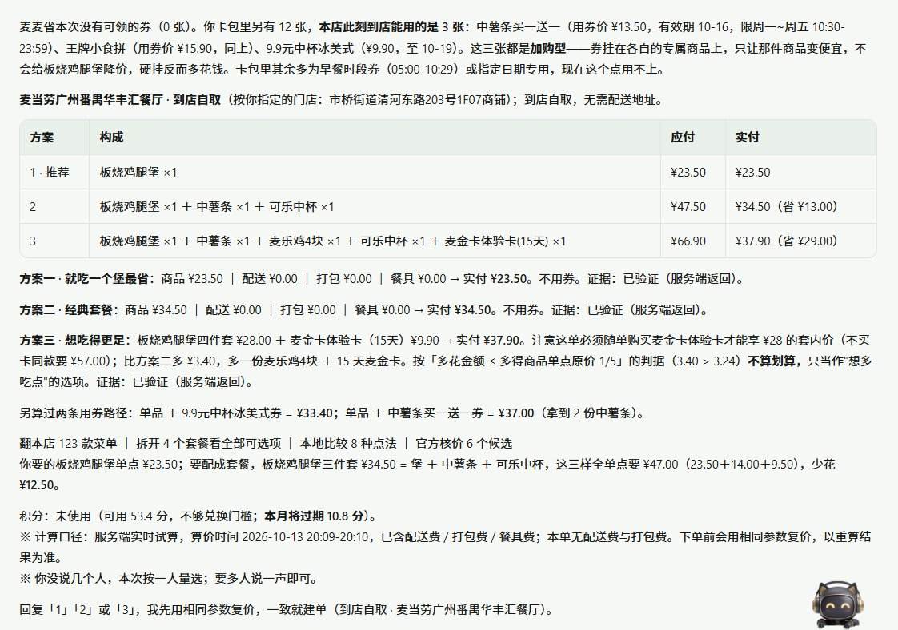
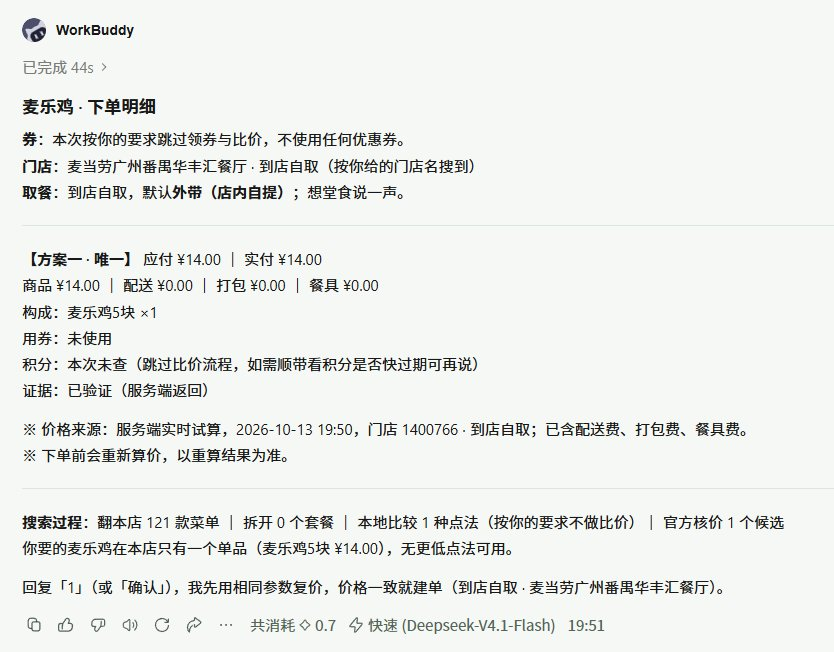

# 麦麦省钱机器人 · mcd-saver

> 把「这次怎么点最省」从一个凭感觉的问题，变成服务端算出来的答案。

在麦当劳点餐时自动省钱：**自动领券 → 筛出这家门店此刻真正能用的券 → 按人数、预算、忌口与常点生成候选 → 交由服务端实时算价 → 选出实付最低的组合 → 确认后创建待支付订单**。

本项目是「麦当劳程序员创意开发大赛」参赛作品，基于**麦当劳中国 MCP 服务**开发，使用 **WorkBuddy** 完成编码与调试。

> ⚠️ 本项目为参赛者独立开发的创意作品，**非麦当劳官方产品**。项目输出仅供参考，餐品信息、价格及供应状态以麦当劳官方渠道的实时结果为准。

---

## 一、它解决什么问题

麦当劳的一份餐，价格从来不是一个数字，而是一组约束下的结果：

| 约束 | 为什么人脑算不清 |
|---|---|
| **渠道** | 到店自取与麦乐送的门店、配送费、打包费、券的渠道标签完全不同 |
| **时间** | 券带星期与时段限制（例如「周二 05:00–10:29」），此刻能用 ≠ 待会儿能用 |
| **组合** | 套餐比单点便宜，但套餐里未必是你想吃的那款 |
| **券** | 加购型券挂上去反而更贵——它要求你先买一张卡 |
| **积分** | 积分、随单购、门槛差额（还差几元能享优惠）互相纠缠 |

这是一个**组合优化问题**，不是一个查询问题。凭感觉点，最后往往多花十几块。

---

## 二、效果示例（真实调用数据，非示意）

**场景**：到店自取 · 一个人 · 想吃巨无霸
**门店**：麦当劳上海黄浦华旭国际大厦餐厅（`storeCode 1450713`）· 来源：按地址搜索选定

| 候选 | 构成 | 原价 | 实付 | 说明 |
|---|---|---:|---:|---|
| **A 巨无霸三件套** | `9900005466` ×1 | ¥36.50 | **¥36.50** | ✅ 命中目标商品，实付最低 |
| B 单点自己拼 | 巨无霸 ×1 + 中薯条 ×1 + 可乐 ×1 | ¥48.50 | ¥48.50 | 比 A 贵 **¥12.00** |
| C 麦香鸡中套餐 | `9900005453` ×1 | ¥28.00 | ¥28.00 | 更便宜，但不是牛肉堡，未命中目标商品，列为备选 |

**券的实测抵扣**（同日同店，交由服务端算价验证）：

| 券 | 原小计 | 实付 | 抵扣 |
|---|---:|---:|---:|
| 中薯条买一送一 | ¥27.00（2 份） | **¥13.50** | **¥13.50** |

> 以上金额全部来自 2026-10-13 16:42 的**服务端算价接口返回值**（接口单位为「分」，展示时换算为「元」）。完整调用记录见 [`docs/verification.md`](docs/verification.md)。**本项目不做本地估算价格。**

### 运行截图（2026-10-13 实际运行）

**多方案比价与券分析**——卡包 12 张券中筛出本店此刻真实可用的 3 张，给出 3 套方案并逐套服务端算价，标注省了多少、哪套"不算划算"以及为什么：



**下单明细**——实付金额按商品 / 配送 / 打包 / 餐具四项拆分，价格来源标注为服务端实时试算：



---

## 三、安装

### 1. 取得麦当劳 MCP Token

前往麦当劳 MCP 开放平台申请（参见 [mcd-mcp-server 使用指南](https://github.com/M-China/mcd-mcp-server)）：手机号登录 → 控制台 → 激活 → 复制 Token。

### 2. 在 WorkBuddy 中配置连接器

打开 WorkBuddy → 左侧【专家·技能·连接器】→【连接器】→ 右上角【自定义连接器】→【配置 MCP】，填入 [`mcp-config.example.json`](mcp-config.example.json) 的内容，并把 `${MCD_MCP_TOKEN}` 替换成你自己的 Token：

```json
{
  "mcpServers": {
    "mcd-mcp": {
      "type": "streamablehttp",
      "url": "https://mcp.mcd.cn",
      "headers": {
        "Authorization": "Bearer ${MCD_MCP_TOKEN}"
      }
    }
  }
}
```

> 示例文件中的 `${MCD_MCP_TOKEN}` 是占位符，**必须替换为你自己的 Token 才可用**。请不要把真实 Token 提交到任何仓库。

保存后回到【自定义连接器】，将 `mcd-mcp` **启用**。

### 3. 安装本 Skill

把本仓库整个目录放进 WorkBuddy 的技能目录：

```bash
git clone https://github.com/<your-account>/mcd-saver.git
mkdir -p ~/.workbuddy/skills
cp -r mcd-saver ~/.workbuddy/skills/mcd-saver
```

Windows（PowerShell）：

```powershell
git clone https://github.com/<your-account>/mcd-saver.git
New-Item -ItemType Directory -Force "$env:USERPROFILE\.workbuddy\skills" | Out-Null
Copy-Item -Recurse -Force .\mcd-saver "$env:USERPROFILE\.workbuddy\skills\mcd-saver"
```

### 4. 环境自检（可选）

```bash
python scripts/check_environment.py --capability 最优组合试算 --probe-results ./probe-results.json
```

只读检查，不修改配置、不登录、不授权。输出 `ready` / `partial` / `needs_setup` / `unavailable` 四种状态，并给出对应的降级方案。

---

## 四、使用示例

在 WorkBuddy 对话里直接说：

```
帮我点最便宜的
省钱点餐
今天最划算的套餐
这家店怎么点最省
有没有券能用
两个人吃控制在六十以内
不要香菜，帮我配一个便宜的
积分换个什么划算
```

**发起后会发生什么**：

1. **第一次会问渠道**（到店自取 / 麦乐送）。渠道决定门店与算价口径，所以排在最前面问。
2. **第二次问门店或配送地址**。给模糊地址（如「体育西路附近」）时，会搜附近门店并摆出前几家让你选——**不会自行替你挑最近的**，选错店会让整单价格全错。
3. 随后自动领券、拉菜单、拉门店可用券、拉积分，**并发**发起，不串行等待。
4. 生成最多三个候选，逐个交服务端算价，按**实付价**排序。
5. 输出方案明细（商品清单、所用券、四项费用拆解、原价 / 优惠 / 实付、省了多少、券有效期、将过期积分提醒）。
6. 你说「确认 + 序号」后**复价一次**，价格一致才创建订单，给出支付入口。
7. **只创建待支付订单，绝不代付。**

第二次使用起，如果三十天内有历史下单记录，会直接沿用上次的渠道与门店，并回显「按上次下单的门店与渠道」，同时给你一个改门店的低成本入口。

---

## 五、MCP 调用链

完整说明见 **[MCP_INTEGRATION.md](MCP_INTEGRATION.md)**。核心链路：

```
now-time-info ────────► 服务器时间与星期（券过滤的必需输入）
        │
        ├─ query-nearby-stores / delivery-query-addresses + delivery-query-stores
        │        └─► 拿到 storeCode / beCode（门店编号只取接口返回值）
        │
        ├─ auto-bind-coupons + available-coupons ×2 ─► 领券（用「可领取」条数差值判定）
        ├─ query-meals ───────────────────────────────► 菜单 + 服务端常点清单
        ├─ query-store-coupons ───────────────────────► 唯一可信的可用券来源
        ├─ query-my-account ──────────────────────────► 积分（含本月/下月将过期）
        ├─ query-my-coupons ──────────────────────────► 卡包券文本（提醒与过滤）
        │
        ├─ query-meal-detail ─────────────────────────► 核实套餐里到底有什么（按需）
        ├─ calculate-price ×N ────────────────────────► 服务端算价，实付价排序
        │
        └─ create-order ──────────────────────────────► 创建待支付订单
                │
                └─ order-list（异常时先查，避免重复建单）/ cancel-order
```

---

## 六、为什么它的报价可信（设计原则）

这部分是本项目与「套壳一问一答」的分界线：

| # | 原则 | 违反的后果 |
|---|---|---|
| 1 | **价格只信服务端算价**，绝不本地推算冒充实付 | 报价错误，用户多付钱 |
| 2 | **门店编号一律取自接口返回的 `storeCode` / `beCode`**，不用地址文本 | 选错门店，整单价格全错 |
| 3 | **算价返回必与请求逐项核对**（数量、构成、券是否生效、金额自洽），不符的候选作废 | 把无效候选当成最优解推荐 |
| 4 | **搜索过程的数字必须真实**，没做过的比对不写进输出 | 一旦编数字，整条技能的可信度归零 |
| 5 | **不对写接口裸重试**，重试前必须先查 `order-list` | 生成重复订单 |
| 6 | **动用积分逐笔单独确认**，任何模式都不豁免 | 擅自消耗用户资产 |
| 7 | **拿不到真实价格就直说算不出**，不推估算价 | 用假数据骗取信任 |
| 8 | **不隐藏券的有效期与时段** | 用户到店发现券不能用 |

配套的降级矩阵：任何一项能力不可用时，**只关闭受影响的功能**，不笼统宣布整个 Skill 不可用。例如券接口不可用时走「无券价最优」并标注本次未使用券；算价全部失败时**停止并输出零个金额**。

---

## 七、目录结构

```
mcd-saver/
├── SKILL.md                    技能主文档：能力边界、意图分流、九步流程、质量自查
├── skill-dependencies.json     依赖清单：能力映射、健康检查、逐项降级方案
├── scripts/
│   └── check_environment.py    只读环境检查（仅标准库，无第三方依赖）
├── references/
│   ├── field-manual.md         接口字段手册与单位陷阱（最容易出错的地方）
│   ├── coupon-rules.md         券的三层结构、过滤、挂载与叠加
│   ├── pricing-playbook.md     目标函数、候选生成、预算、凑单、排序
│   ├── order-placement.md      确认、复价、建单、回执与幂等
│   ├── output-template.md      三套输出模板与排版规则
│   ├── push-template.md        每日推送字段与话术
│   ├── user-profile.md         本地档案字段与结论缓存
│   └── setup-guide.md          配置、验证、撤销与降级
├── docs/
│   └── verification.md         真实调用验证记录（工具、参数、返回形状）
├── README.md
├── MCP_INTEGRATION.md          麦当劳 MCP 集成说明（工具、流程、业务价值）
├── mcp-config.example.json     脱敏配置示例（仅环境变量占位符）
└── CONTEST_DECLARATION.md      参赛声明（官方原文）
```

---

## 八、目标用户

- **每天中午纠结「怎么点便宜」的上班族**——不想在十几个套餐里人肉比价
- **手上有券却从不记得哪张能用的人**——券带了渠道、星期、时段三重限制
- **需要一次点几份、还要控预算的人**——家庭、宿舍、同事拼单
- **麦乐送与到店自取混用的人**——想比较哪种方式当前更划算
- **不想被「加购型券」套路的人**——省了 5 元但多买了一张卡

---

## 九、已知边界

本 Skill **不做**这些（会如实说明，不用模糊应答糊过去）：

```
配送进度查询、订单追踪、发票、自动抽奖、派对类积分兑换、跨店比价
```

- **不使用系统级定位**。场景信息来自用户回答或历史记录，不读取设备位置。
- **不自动支付**，也不宣称已付款。
- **付款只能在麦当劳 App 内完成**。官方 MCP 建单后返回的是待支付订单，付款需扫码跳转到麦当劳 App 支付，本 Skill 无法代付、也不提供其他付款方式。
- **不掌握门店实时营业动态**，业务状态以接口返回为准。

---

## 十、合规与免责

- 本项目不包含任何真实 Token、密钥或账号凭证，配置文件仅使用占位符。麦当劳会员授权由连接器侧承载，本 Skill 不接触密码、令牌或 Cookie，也不要求用户在对话中粘贴凭据。
- 本项目由参赛者独立开发，**非麦当劳官方产品**，不构成对麦当劳及其关联方商标的任何授权或背书。
- 项目输出仅供参考，**不构成医疗、营养或其他专业建议**；餐品信息、价格及供应状态以麦当劳官方渠道的实时结果为准。
- 使用麦当劳 MCP 服务须遵守麦当劳中国的《使用条款》及《麦当劳 MCP 服务规则》。

---

## 十一、许可

[MIT License](LICENSE)

---

## 十二、参赛信息

本项目参加 **麦当劳程序员创意开发大赛**（2026-10-09 ~ 2026-10-25），使用 WorkBuddy 开发。

- 赛事主仓库：[M-China/mcd-developer-innovation-challenge](https://github.com/M-China/mcd-developer-innovation-challenge)
- 麦当劳 MCP 使用指南：[M-China/mcd-mcp-server](https://github.com/M-China/mcd-mcp-server)
